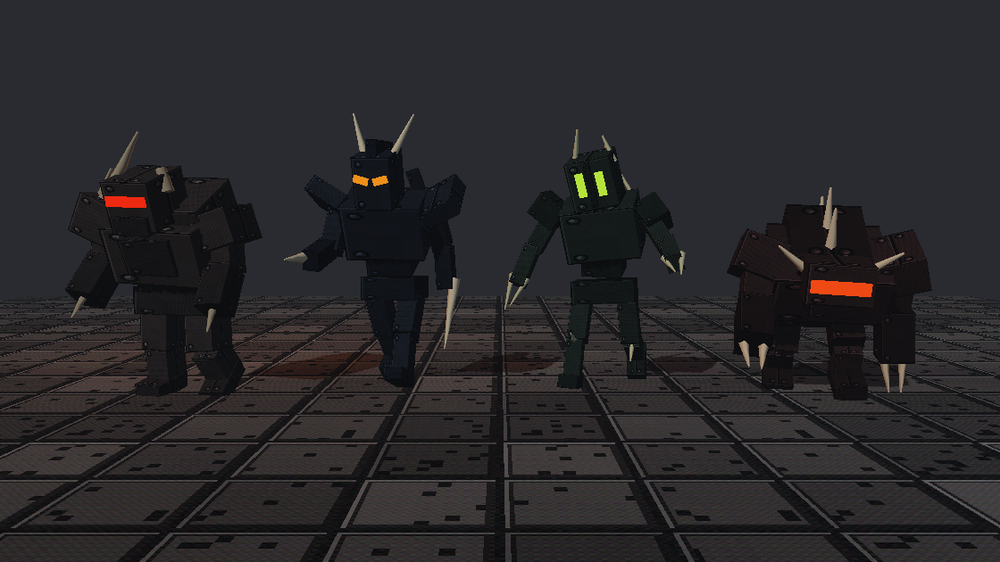
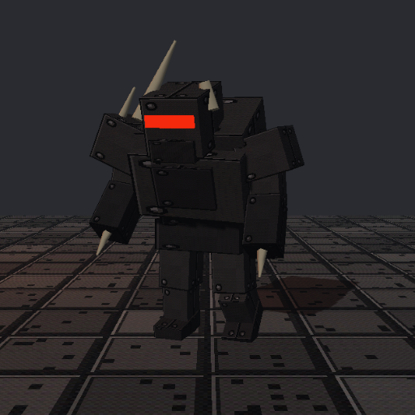
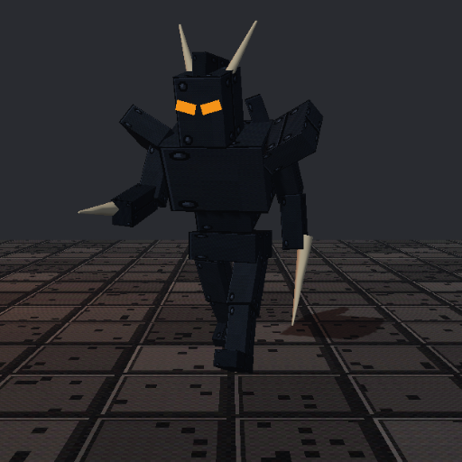
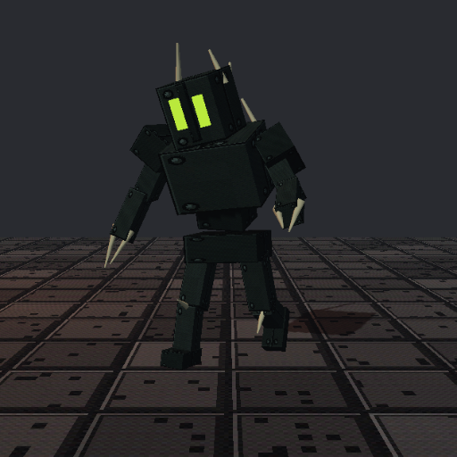
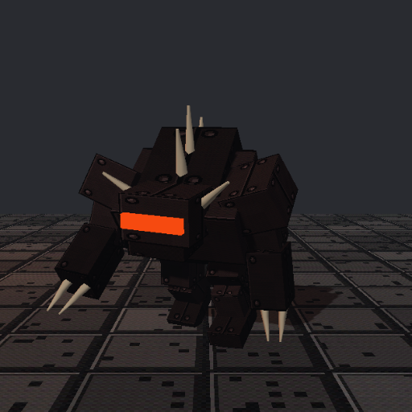

# Iron Pit — Bestiary (Enemies)

Every fiend in the Iron Pit is a living sliver of Mor'gath's soul. Each AI role has its own low-poly silhouette, weathered iron tint, glowing visor cue, and procedural joint animations (**chase stride**, **close-range claw slash**, **airborne leap**, **hit stagger**, and **ragdoll death splay**).

*Left to right: **Iron Brute** (`RUSHER`), **Cinder Stalker** (`FLANKER`), **Ash Wraith** (`WEAVER`), **Iron Prowler** (`LUNGER`).*

---

## Quick Reference

| Name | AI Role | Debut | Armor Tint | Visor Cue | Core Behavior |
| :--- | :--- | :--- | :--- | :--- | :--- |
| **Iron Brute** | `RUSHER` | Wave 1 | Rusted Iron | Crimson horizontal slit | Direct pursuit, heavy stomping charge |
| **Cinder Stalker** | `FLANKER` | Wave 1 | Slate Iron | Twin V-angled amber eyes | Wide lateral flanking arcs, cuts in close |
| **Ash Wraith** | `WEAVER` | Wave 2 | Oxidized Green-Ash | Dual vertical sulfur-green slits | Sinusoidal zig-zag weave, straightens close |
| **Iron Prowler** | `LUNGER` | Wave 3 | Charred Rust | Orange-red → **white-gold** flare | Crouched windup telegraph → airborne lunge |

---

## 1. Iron Brute (`RUSHER`)

- **Debut:** Wave 1
- **Visual Cues:** Broad hunched rusted-iron cuirass, asymmetrical long left horn and broken right stump, spiked left pauldron, heavy iron greaves, single **crimson horizontal visor**.
- **Behavior & Motion:** Charges straight at the player with a heavy, deliberate stomping stride and overhead-hook claw slashes at close range.

---

## 2. Cinder Stalker (`FLANKER`)

- **Debut:** Wave 1
- **Visual Cues:** Tall, lean slate-iron frame, twin outward-swept horns, flared back blade fins, **twin V-angled amber eyes**, and long bone-iron **scythe blades** on both forearms.
- **Behavior & Motion:** Faster than the Brute; arcs laterally around the player at mid-range while banking into turns, then cuts directly inward at close range.

---

## 3. Ash Wraith (`WEAVER`)

- **Debut:** Wave 2
- **Visual Cues:** Crooked oxidized green-ash ribcage, three jagged iron rods jutting from its back, tilted barred **iron cage-helm** with **dual vertical sulfur-green slits**, iron knee spurs, and forked twin talons.
- **Behavior & Motion:** Weaves unpredictably side-to-side to throw off aim while closing in, accompanied by an eerie twitching head tilt and splayed arms.

---

## 4. Iron Prowler (`LUNGER`)

- **Debut:** Wave 3
- **Visual Cues:** Low-slung coiled charred-rust beast, three prominent **dorsal iron spine spikes**, wide bull horns, oversized gorilla-like pounce claws, and a wide **orange-red visor**.
- **Behavior & Motion:** At mid-range (`3.8m–10.5m`), halts and drops into a deep crouched windup (`0.36s`) while flaring its visor **bright white-gold** and groaning—then launches a fast airborne pounce. Shooting it during windup interrupts the lunge.

---

## Shared Combat Animations

- **Chase Stride:** Alternating hip/knee swing, counter-swinging arms, vertical stride bob, and lateral turn banking scaled to each archetype's cadence.
- **Close Slash:** Snappy alternating left/right claw swipes inside melee reach.
- **Airborne Leap:** Stretched forward claws and trailing legs during lunges, obstacle vaults, and vertical pursuit leaps.
- **Hit Stagger:** Brief white armor flash with backward torso recoil and flaring arms on non-lethal hits.
- **Knockdown Death:** Splayed death pose locked onto the rig while Jolt physics unlocks angular axes and launches the body backward.
